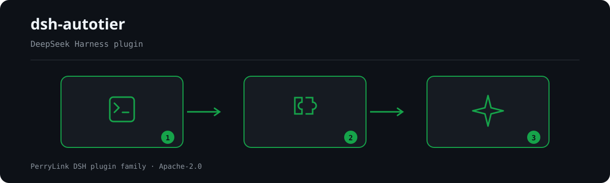

# dsh-autotier

[](https://gitee.com/perrylink/dsh-autotier)
[](LICENSE)
[](https://github.com/topics/dsh-plugin)
[](https://github.com/PerryLink/dsh-plugin-doctor#verified-徽章)
[](https://dsh.market/)
[](#)
[](https://github.com/PerryLink/dsh-autotier/actions)
[](https://github.com/PerryLink/dsh-autotier/releases)
[](https://dshfind.com/zh/plugins/PerryLink/dsh-autotier?ref=badge)

[English](README.md) | **简体中文** | [Español](README-es.md) | [Português](README-pt.md) | [हिन्दी](README-hi.md)

```sh
dsh plugin --profile <name> add dsh-autotier
```


DeepSeek Harness 的自动模型分档路由：一条用户指令进来，一个档位决策出去 ——
无需手动切换模型。

复杂意图（架构、规划、调试、多步工程）先由**强档**规划，再由**弱档**实施；
简单意图（问答、检索、批量杂务、日常）直接由**弱档**设计并实施。弱档执行期间，
高危工具调用会被确定性守卫拦截；连续失败则按 TTL 自动升级到强档。

- **官方仓库**：<https://github.com/PerryLink/dsh-autotier>
- **npm**：`dsh-autotier`（裸名，无 scope）


**📖 生态实测知识库**（实测数据，不是营销）：[插件开发指南 · 选型实测数据 · 维护取舍判据](https://perrylink.github.io/dsh-plugin-guide/)。

<!-- star-cta -->
## ⭐ 如果它帮到了你

这个插件是 [DSH 插件家族](https://github.com/PerryLink)的一员（95 个，全部 Apache-2.0）。如果你在用，**给个 star** —— 它不会解锁任何功能，但会让下一个人在搜索里更容易找到它。

*English:* part of a 95 plugin family for DeepSeek Harness. If it is useful, **a star helps the next person find it** — nothing is gated behind it.

## What is dsh-autotier?

npm 通道

git 通道



*工作流概览：调用 → 插件 → 结果。下面的示例使用实际命令面。*


*同一次运行，动图版。*

## 兼容性

| Harness | 状态 |
|---|---|
| `@deepseek-ai/dsh` `0.1.2-rc.1` | 不再支持；该线早于本插件现在对准的 `SettingsForms` 契约 |
| `@deepseek-ai/dsh` `0.1.5-rc.2` | 不再支持；它所暴露的 `settings.register` / `settings/updated` 契约已被上游删除 |
| `@deepseek-ai/dsh` `0.1.6-alpha.2` | 不再支持；同一处删除，首个带 `SettingsForms` 的版本 |
| `@deepseek-ai/dsh` `0.1.7-rc.2` | **必需**；已对同版 checkout（`typecheck`）与已发布包（`typecheck:ci`、214 项测试）双向验证 |
| `@deepseek-ai/cordis` `^4.0.3`、`@deepseek-ai/cosmokit` `^1.8.4`、`@deepseek-ai/schemastery` `^3.18.3` | peer 基线 |

peer 范围显式列出四条已发布线（`>=0.1.6-0 <0.2.0 || >=0.2.0-0 <0.3.0 || >=0.2.1-0 <0.3.0`）——因为仅含较早版本元组预发布比较符的 semver 范围无法接纳更晚的 alpha；
每次发布波同步刷新。声明的范围刻意宽于已验证范围：它记录清单接受什么，而不是测过什么。

**本次发布是破坏性适配。** `0.1.6` 代宿主移除了本插件赖以构建的 settings **provider** 缝：
`@deepseek-ai/dsh-settings-file` 整包消失，`ctx.settings` 现为 `SettingsForms`
（schema→表单投影器，没有 `register`），`settings/updated` 亦不复存在。没有任何共享面能让一个插件观察另一个插件的设置文档，
因此本插件无法同时支持两种契约。配置现在走宿主的 volatile 配置机制；真正在运行时改变行为的
**按会话路由模式**未变。

本插件只驻留 host 平面，不需要自带 agent preset：host 行对所有会话生效。
在你的 preset 中加一段提示是可选项，仅用于让模型看见路由决策
（见[安装与卸载](#安装与卸载)）。

## 功能

- **意图门控** —— 每个 turn 都用确定性信号（消息文本、工具名、是否含图、
  对话长度）分类。零 token 的规则层有把握时直接决策；只有低置信 turn 才会调用
  廉价的裁判模型，且受冷却时间约束。
- **落点在官方 seam** —— 决策在 `agent/request` waterfall 上通过返回替换后的
  provider/model/effort 三元组生效；会话已选定的采样标量（`temperature`、
  `maxTokens`、`stop`）保持不变。
- **计划模式交接** —— 复杂指令在强档进入计划模式；退出计划模式后回到弱档实施。
- **高危守卫** —— 弱档执行期间，破坏性命令（`rm -rf`、`sudo`、`mkfs`、
  `git push --force`、写凭据文件等）会被拒绝，并给出"请先升级"的纠正信息。
- **失败升级** —— 连续失败（可按同签名计数）会临时提升档位；模型/链路故障会沿
  配置的回退链换档。
- **手动逃生舱** —— `/tier auto|strong|cheap|off` 与 `tier_status` /
  `tier_route` 工具。设置 `routingMode: delegated`（或 `/tier off`）可为必须保留
  自身模型的会话关闭路由。
- **`ctx.autotier` 服务** —— 精简的只读面（`status`），外加
  `autotier/route` 否决 waterfall 与 `autotier/tier-changed` 事件，便于其他
  插件观察或覆盖决策。

## 快速开始

```sh
dsh plugin --profile web add github:PerryLink/dsh-autotier
```

```bash
npm i -g dsh1024
dsh1024 plugin --profile web add dsh-autotier
```

随后启动（或重启）harness。该行会被追加到你的 profile `cordis.patch.yml`；
下一个 turn 起自动路由，无需其他配置。

## 安装与卸载

**npm 通道**

```bash
npm i -g dsh1024
dsh1024 plugin --profile web add dsh-autotier
```

**git 通道**

```bash
git clone https://github.com/PerryLink/dsh-autotier.git
cd dsh-autotier && pnpm install && pnpm run build
dsh plugin --profile web add .
```

**可选的 preset 提示段**：不加也能工作。若想让模型知道自己跑在哪一档，在
*你自己的* agent preset 中加一行（完整块见 `docs/preset-row.md`）：

```yaml
- insert:
    - id: autotier-prompt
      name: '@deepseek-ai/dsh-system-prompt'
      # sections: [...]  — 见 docs/preset-row.md
```

**卸载**

```bash
dsh plugin --profile web remove dsh-autotier
```

该行、settings 命名空间、命令、工具与全部监听器都随插件移除；除设置文档外
不会在别处留下任何写入。

### 示例

以下为插件真实入口；安装后调用一个即可。

#### 详细示例

- `/tier`

#### 简短示例

- `tier_status`
- `tier_route`

## 配置

每个键都在加载期校验；非法值会响亮失败，而不是静默关闭路由。本仓
`cordis.patch.yml` 内联注释了同一组键。

| 键 | 默认值 | 含义 |
|---|---|---|
| `tiers.strong.provider` | `deepseek-official` | 规划/复审档的 provider。 |
| `tiers.strong.model` | `deepseek-v4-pro` | 强档模型的目录 id。 |
| `tiers.strong.effort` | `high` | 适配器词表 `off` \| `low` \| `high` \| `max`。 |
| `tiers.strong.followSession` | `false` | `false` = 本档 effort 覆盖会话自身的设置。 |
| `tiers.strong.fallback` | `[]` | 该档不可用时的有序 provider/model 落点。 |
| `tiers.cheap.provider` | `deepseek-official` | 实施档的 provider。 |
| `tiers.cheap.model` | `deepseek-flash` | 弱档模型的目录 id。 |
| `tiers.cheap.effort` | `low` | 适配器词表 `off` \| `low` \| `high` \| `max`。 |
| `tiers.cheap.followSession` | `true` | `true` = 继承会话 effort，让显式选择优先。 |
| `tiers.cheap.fallback` | `[]` | 该档不可用时的有序 provider/model 落点。 |
| `tiers.vision.provider` | `deepseek-official` | 含图 turn 的 provider。 |
| `tiers.vision.model` | `deepseek-flash` | 目录中唯一支持图像模态的模型。 |
| `intent.ruleThreshold` | `0.7` | 规则层可独立决策的置信度下限。 |
| `intent.attemptBand.enabled` | `false` | 中间波段：先跑弱档，出现信号再升级。 |
| `intent.attemptBand.tauLow` | `0.45` | attempt-first 波段的下界。 |
| `intent.hysteresis.toStrong` | `0.8` | 弱档 turn 切到强档的分数。 |
| `intent.hysteresis.toCheap` | `0.6` | 强档 turn 回落到弱档的分数。 |
| `intent.rules` | `[]` | 声明式规则表（`when.patterns` / `when.tools` / `when.cwd`、`tier`、`priority`）。 |
| `intent.judge.enabled` | `true` | 是否允许低置信裁判。 |
| `intent.judge.model` | `''` | 裁判模型 id；空 = 取目录中第一个含 `flash` 的模型。 |
| `intent.judge.temperature` | `0` | 裁判采样温度。 |
| `intent.judge.maxTokens` | `16` | 裁判输出上限（只回答一个词）。 |
| `intent.judge.cooldownMs` | `30000` | 两次裁判调用的最小间隔。 |
| `intent.judge.timeoutMs` | `2000` | 裁判调用超时。 |
| `intent.judge.unavailableSkip` | `2` | 连续失败多少次后本 turn 跳过裁判。 |
| `intent.scenarios` | 全 `true` | 分场景开关：`coding`、`review`、`planning`、`retrieval`、`batch`、`daily`、`longText`、`multimodal`。 |
| `intent.costMode` | `balanced` | 歧义裁决方向：`cost-first` \| `quality-first` \| `balanced`。 |
| `guard.enabled` | `true` | 启用确定性高危守卫。 |
| `guard.tiers` | `[cheap]` | 守卫保护的档位。 |
| `guard.whitelist` | `[]` | 永不触发守卫的命令、工具或路径前缀。 |
| `guard.protectedPaths` | `['.dsh','AGENTS.md','package.json','.github/workflows']` | 触发强档复核的自修改表面。 |
| `guard.interopDefend` | `auto` | 与 `dsh-defend` 的关系：`auto` 审计共存，`none` 保持安静。 |
| `escalation.threshold` | `2` | 窗口内达到该失败数即升级档位。 |
| `escalation.windowMs` | `60000` | 失败计数窗口。 |
| `escalation.ttlMs` | `180000` | 升级保持有效的时长。 |
| `escalation.fallbackTtlMs` | `300000` | 已走回退落点后使用的 TTL。 |
| `escalation.signature` | `true` | 按同签名复发计数，而非统计每次失败。 |
| `routingMode` | `auto` | `auto` \| `strong` \| `cheap` \| `delegated` \| `off`。 |

所有键也可在 Plugins 页的本插件卡片上热改：Host 先按 schema 校验新值，
再以 `loader/volatile-update` 提交；本插件随后用与挂载期同一套跨字段判据
重新裁决整份配置。违反跨字段要求的值（两个 tier 落在同一路由、
无法止住抖动的滞回对、既无 pattern 也无 tool 的规则）会让**上一份可用策略**
继续生效，而不是换上一个无法路由的配置。

`routingMode` 是唯一**不**热更的键：它是组合默认值，运行时开关是由
`/tier`、输入框胶囊与卡片选择器写入的按会话覆盖。让它同时热更
会让同一行为有两个归属。

## 工具与表面

| 表面 | 类型 | 用途 |
|---|---|---|
| `/tier` | 命令 | `auto` \| `strong` \| `cheap` \| `off` \| `status`；会话级覆盖。 |
| `tier_status` | 工具 | 当前档位、模式、升级 TTL 与守卫状态。 |
| `tier_route` | 工具 | 对一段意图做干跑路由，不发送请求。 |
| `ctx.autotier` | 服务 | 供其他插件读取的 `status()` 面。 |
| `autotier/route` | serial 事件 | 第三方可否决拟定的档位。 |
| `autotier/tier-changed` | emit 事件 | 生效档位变化时的可观测性事件。 |

## 权限与数据

- **文件** —— 本插件不读文件、不写文件，唯一的写入路径是共享 settings 服务的
  `autotier` 命名空间。
- **网络** —— 唯一的出站流量是裁判调用，走正常的 `ctx.llm` 路径与所配置的
  provider。
- **会话日志** —— 本插件不追加任何自定义会话事件。路由留痕 = 插件 logger 与
  实时 `autotier/tier-changed` 总线事件；唯一的写入是 plan-mode 服务缺失时回退
  追加的 `plan/mode`。`0.1.2-alpha.1` 起自定义事件类型 fail-closed，因此不会留下
  插件自有的持久记录。
- **凭据** —— 本插件不读取、不记录、不存储任何凭据。

## 安全边界

- 守卫是**纵深防御**，不是沙箱。它只拒绝弱档上已知的模式，绝不削弱
  `dsh-defend`、审批服务或 sandbox 策略 —— 请保持它们开启。
- 守卫只保护 `guard.tiers` 列出的档位（默认 cheap）。强档 turn 按设计不被拦截：
  强模型本身就是复核者。
- 守卫自身抛错时，调用会被升级到强档而不是放行 —— 坏掉的守卫不能变成敞开的门。
- `/tier off` 完全关闭路由；harness 的行为与安装本插件之前完全一致。

## 已知限制

- 规则层是确定性的、因而也是有限的：复杂请求若换了说法，可能先落到弱档，只有
  失败或守卫拒绝之后才升级。低置信的中间地带由裁判调用覆盖。
- 升级状态按 agent 保存在内存中；harness 重启后从 `auto` 重新开始。
- 切换档位会重置该请求的 provider 提示缓存，因此极高频会话在切换 turn 可能看到
  少量缓存未命中成本；迟滞阈值的存在就是为了让这件事少见。
- 本插件只路由对话请求。压缩与标题生成是宿主独立的 seam；若想获得同样的成本
  画像，请把它们各自的模型设置对齐到弱档（`docs/supporting-lanes.md`）。
- 弱档 `followSession: true` 意味着会话中显式选择的模型优先；此时弱档无法强制
  使用自己的模型。
- **Settings 卡片与 composer 胶囊已于 0.2.0 交付**。卡片（路由模式、实时档位落点、
  模型目录）位于 Plugins 设置区，胶囊在输入区循环切换会话档位。
- **GUI 里改选模型不会被自动识别**。请用 `routingMode: delegated` 或
  `/tier off` 关闭路由。
- **指纹后验仅存于内存**，重启后重新学习。
- **attempt-first 中间波段默认关闭**，待校准语料落地后（v0.2）开启。

## 开发

```bash
pnpm install
pnpm run typecheck      # 对照本地 harness checkout 的类型面
pnpm run typecheck:ci   # 对照已发布的 0.1.7-rc.2 类型面（CI 实际执行）
pnpm test
pnpm run build
pnpm run verify:self-contained
pnpm run verify:artifacts
pnpm pack
```

`pnpm run build` 产出 `lib/types`（tsc 声明）与 `lib/index.js`（tsdown 打包）。
测试直接使用已发布的宿主包 —— 真实 `Context`、真实 session/tools/commands/
settings 服务 —— 外加一次针对临时 `cordis.yml` 的真实 Loader 组合。

## 主题

`dsh`、`dsh-plugin`、`deepseek-harness`、`deepseek`、`cordis`、`router`、
`model-tier`、`cost`、`auto`。

## 贡献者

PerryLink。欢迎在 <https://github.com/PerryLink/dsh-autotier/issues> 提 issue
或 PR。

## 许可证

Apache-2.0。见 [LICENSE](./LICENSE) 与
[THIRD_PARTY_NOTICES.md](./THIRD_PARTY_NOTICES.md)。

**适用的 DSH 版本：** 已在 `dsh-v0.2.1-rc.2`（本构建所针对的宿主版本）上验证；要求 `>=0.1.7-alpha.1 <0.2.0`。

## 与其他 DSH 插件的互操作

已对照 **DSH `0.2.0-rc.2`**（本 README 面向的运行时）与 2026-10-05 实测的高星插件集验证。

本插件**不干扰**其他插件，包括广泛安装的高星插件：

- **无工具名冲突。** 所有工具都带命名空间，不占用任何已被内置工具或其他插件持有的裸名。
- **无服务键冲突。** 只提供 `autotier`；该键既不是内置 seam，也没有被任何已调研的高星插件提供。
- **无 slot 冲突。** 不注册客户端 slot key，因此不参与 `shadows-shipped-ui` 座位争抢。
- **无 HTTP 路由冲突。** 不注册任何 `webServer` 前缀。
- **无 patch 层冲突。** 组合包 patch 只 `insert` 自己那一行，从不覆写内置行的 `config`。
- **无全局改写。** 不改原型、不改写 `process.env`、不替换全局 fetch dispatcher。

**共享事件监听器在构造上就不互相干扰。** 它用 `ctx.on()` 监听顺序敏感事件 `agent/created`, `agent/request`, `agent/request-error`, `tools/pre-execute` —— Cordis 的**广播**语义：每个监听器都会运行，任何一个都无法饿死其他监听器。**此处每个监听器都通过 `next()` 委托**，因此链条绝不会被短路；改写作用在 `next()` 产出的值上，而不是用它顶替返回：
  - `agent/request` — also used by `dsh-agent-teams` (1923★), which short-circuits by throwing without calling `next()`.
  - `tools/pre-execute` — also used by `cc-safety-net` (1576★).

静态证据：`dsh-plugin-doctor` 的 K10–K13 在本仓全部为 `pass`。

## PerryLink DSH Plugin Family

本项目是 [PerryLink](https://github.com/PerryLink) 维护的 DeepSeek Harness 插件家族成员。完整名单默认折叠，避免每个 README 的首屏被长表淹没；点击展开可查看每一行及其状态。

<details>
<summary>展开全部插件</summary>

| 插件 | 状态 |
|---|---|
| **[dsh-aqua-input-check](https://github.com/PerryLink/dsh-aqua-input-check)** |  |
| **[dsh-archive-check](https://github.com/PerryLink/dsh-archive-check)** |  |
| **[dsh-auto-review](https://github.com/PerryLink/dsh-auto-review)** |  |
| **[dsh-autotier](https://github.com/PerryLink/dsh-autotier)** |  |
| **[dsh-bid-ca-precheck](https://github.com/PerryLink/dsh-bid-ca-precheck)** |  |
| **[dsh-bid-qual-check](https://github.com/PerryLink/dsh-bid-qual-check)** |  |
| **[dsh-cert-mcp](https://github.com/PerryLink/dsh-cert-mcp)** |  |
| **[dsh-checkpoint-rewind](https://github.com/PerryLink/dsh-checkpoint-rewind)** |  |
| **[dsh-click](https://github.com/PerryLink/dsh-click)** |  |
| **[dsh-composer-history](https://github.com/PerryLink/dsh-composer-history)** |  |
| **[dsh-contract-stance](https://github.com/PerryLink/dsh-contract-stance)** |  |
| **[dsh-customs-doc-check](https://github.com/PerryLink/dsh-customs-doc-check)** |  |
| **[dsh-data-quality](https://github.com/PerryLink/dsh-data-quality)** |  |
| **[dsh-demurrage-ledger](https://github.com/PerryLink/dsh-demurrage-ledger)** |  |
| **[dsh-doublecheck](https://github.com/PerryLink/dsh-doublecheck)** |  |
| **[dsh-drill-script-check](https://github.com/PerryLink/dsh-drill-script-check)** |  |
| **[dsh-eia-guide-check](https://github.com/PerryLink/dsh-eia-guide-check)** |  |
| **[dsh-emergency-plan](https://github.com/PerryLink/dsh-emergency-plan)** |  |
| **[dsh-essay-rubric-check](https://github.com/PerryLink/dsh-essay-rubric-check)** |  |
| **[dsh-evidence-check](https://github.com/PerryLink/dsh-evidence-check)** |  |
| **[dsh-export-ctl-check](https://github.com/PerryLink/dsh-export-ctl-check)** |  |
| **[dsh-fast](https://github.com/PerryLink/dsh-fast)** |  |
| **[dsh-fmea-table-check](https://github.com/PerryLink/dsh-fmea-table-check)** |  |
| **[dsh-forecast-penalty](https://github.com/PerryLink/dsh-forecast-penalty)** |  |
| **[dsh-fund-research](https://github.com/PerryLink/dsh-fund-research)** |  |
| **[dsh-github](https://github.com/PerryLink/dsh-github)** |  |
| **[dsh-gongwen-flow-check](https://github.com/PerryLink/dsh-gongwen-flow-check)** |  |
| **[dsh-gongwen-word-check](https://github.com/PerryLink/dsh-gongwen-word-check)** |  |
| **[dsh-guard-plan-qc](https://github.com/PerryLink/dsh-guard-plan-qc)** |  |
| **[dsh-hazchem-check](https://github.com/PerryLink/dsh-hazchem-check)** |  |
| **[dsh-hazplan-check](https://github.com/PerryLink/dsh-hazplan-check)** |  |
| **[dsh-hidden-risk-map](https://github.com/PerryLink/dsh-hidden-risk-map)** |  |
| **[dsh-hs-classify](https://github.com/PerryLink/dsh-hs-classify)** |  |
| **[dsh-icd-rule-check](https://github.com/PerryLink/dsh-icd-rule-check)** |  |
| **[dsh-industry-research](https://github.com/PerryLink/dsh-industry-research)** |  |
| **[dsh-lawcite-adapter](https://github.com/PerryLink/dsh-lawcite-adapter)** |  |
| **[dsh-laya](https://github.com/PerryLink/dsh-laya)** |  |
| **[dsh-lc-doc-check](https://github.com/PerryLink/dsh-lc-doc-check)** |  |
| **[dsh-learning-gap-check](https://github.com/PerryLink/dsh-learning-gap-check)** |  |
| **[dsh-library](https://github.com/PerryLink/dsh-library)** |  |
| **[dsh-local-ai](https://github.com/PerryLink/dsh-local-ai)** |  |
| **[dsh-lsp-actions](https://github.com/PerryLink/dsh-lsp-actions)** |  |
| **[dsh-mask](https://github.com/PerryLink/dsh-mask)** |  |
| **[dsh-mcp-panel](https://github.com/PerryLink/dsh-mcp-panel)** |  |
| **[dsh-medrec-qc](https://github.com/PerryLink/dsh-medrec-qc)** |  |
| **[dsh-memento](https://github.com/PerryLink/dsh-memento)** |  |
| **[dsh-nsfc-form-check](https://github.com/PerryLink/dsh-nsfc-form-check)** |  |
| **[dsh-nurse-record-check](https://github.com/PerryLink/dsh-nurse-record-check)** |  |
| **[dsh-observe](https://github.com/PerryLink/dsh-observe)** |  |
| **[dsh-origin-rvc-check](https://github.com/PerryLink/dsh-origin-rvc-check)** |  |
| **[dsh-ota-review-check](https://github.com/PerryLink/dsh-ota-review-check)** |  |
| **[dsh-output-styles](https://github.com/PerryLink/dsh-output-styles)** |  |
| **[dsh-paper-doc-adapter](https://github.com/PerryLink/dsh-paper-doc-adapter)** |  |
| **[dsh-permission-rules](https://github.com/PerryLink/dsh-permission-rules)** |  |
| **[dsh-permit-report-check](https://github.com/PerryLink/dsh-permit-report-check)** |  |
| **[dsh-pipeline-check](https://github.com/PerryLink/dsh-pipeline-check)** |  |
| **[dsh-pleading-draft](https://github.com/PerryLink/dsh-pleading-draft)** |  |
| **[dsh-plugin-doctor](https://github.com/PerryLink/dsh-plugin-doctor)** |  |
| **[dsh-plugin-guide](https://github.com/PerryLink/dsh-plugin-guide)** |  |
| **[dsh-plugin-kit](https://github.com/PerryLink/dsh-plugin-kit)** |  |
| **[dsh-plugin-upgrade](https://github.com/PerryLink/dsh-plugin-upgrade)** |  |
| **[dsh-policy-brief-draft](https://github.com/PerryLink/dsh-policy-brief-draft)** |  |
| **[dsh-power-loss-split](https://github.com/PerryLink/dsh-power-loss-split)** |  |
| **[dsh-power-ticket-check](https://github.com/PerryLink/dsh-power-ticket-check)** |  |
| **[dsh-ppap-check](https://github.com/PerryLink/dsh-ppap-check)** |  |
| **[dsh-protest-deadline](https://github.com/PerryLink/dsh-protest-deadline)** |  |
| **[dsh-railway-window](https://github.com/PerryLink/dsh-railway-window)** |  |
| **[dsh-repair-order-qc](https://github.com/PerryLink/dsh-repair-order-qc)** |  |
| **[dsh-research-report](https://github.com/PerryLink/dsh-research-report)** |  |
| **[dsh-review-reply-check](https://github.com/PerryLink/dsh-review-reply-check)** |  |
| **[dsh-rulefile-check](https://github.com/PerryLink/dsh-rulefile-check)** |  |
| **[dsh-safety-brief-check](https://github.com/PerryLink/dsh-safety-brief-check)** |  |
| **[dsh-score](https://github.com/PerryLink/dsh-score)** |  |
| **[dsh-session-sync](https://github.com/PerryLink/dsh-session-sync)** |  |
| **[dsh-site-log-check](https://github.com/PerryLink/dsh-site-log-check)** |  |
| **[dsh-skill-pack-security](https://github.com/PerryLink/dsh-skill-pack-security)** |  |
| **[dsh-soe-decision-check](https://github.com/PerryLink/dsh-soe-decision-check)** |  |
| **[dsh-soilwater-check](https://github.com/PerryLink/dsh-soilwater-check)** |  |
| **[dsh-sop-sync-check](https://github.com/PerryLink/dsh-sop-sync-check)** |  |
| **[dsh-spc-gbt-adapter](https://github.com/PerryLink/dsh-spc-gbt-adapter)** |  |
| **[dsh-talk](https://github.com/PerryLink/dsh-talk)** |  |
| **[dsh-tender-extract](https://github.com/PerryLink/dsh-tender-extract)** |  |
| **[dsh-tender-matrix](https://github.com/PerryLink/dsh-tender-matrix)** |  |
| **[dsh-test-drive](https://github.com/PerryLink/dsh-test-drive)** |  |
| **[dsh-ticktick](https://github.com/PerryLink/dsh-ticktick)** |  |
| **[dsh-translate](https://github.com/PerryLink/dsh-translate)** |  |
| **[dsh-warranty-calc](https://github.com/PerryLink/dsh-warranty-calc)** |  |
| **[dsh-budget](https://github.com/PerryLink/dsh-budget)** | 🧊 已冻结 — 见仓库 README |
| **[dsh-claude-move](https://github.com/PerryLink/dsh-claude-move)** | 🧊 已冻结 — 见仓库 README |
| **[dsh-defend](https://github.com/PerryLink/dsh-defend)** | 🧊 已冻结 — 见仓库 README |
| **[dsh-draw](https://github.com/PerryLink/dsh-draw)** | 🧊 已冻结 — 见仓库 README |
| **[dsh-reach](https://github.com/PerryLink/dsh-reach)** | 🧊 已冻结 — 见仓库 README |
| **[dsh-background-agents](https://github.com/PerryLink/dsh-background-agents)** | 🚫 已退役 — 见仓库 README |
| **[dsh-session-pin](https://github.com/PerryLink/dsh-session-pin)** | 🚫 已退役 — 见仓库 README |
| **[dsh-team-rooms](https://github.com/PerryLink/dsh-team-rooms)** | 🚫 已退役 — 见仓库 README |

</details>
